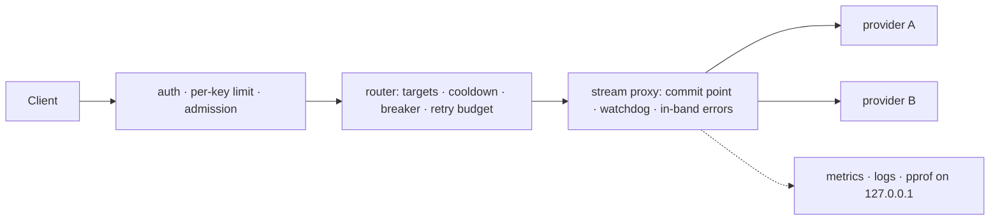

# ModelMesh

**A small LLM gateway in Go whose behavior under failure is specified, tested, and measured.**

ModelMesh sits between your applications and OpenAI-compatible LLM providers. It exposes
one OpenAI-style endpoint and routes each model alias to an ordered list of providers. It
handles retries, failover, circuit breaking, rate limits, and streaming with explicit,
tested rules for what the client sees when something breaks.

It is a single binary built only on the Go standard library. Everything in this repository
(development, every test, the benchmarks, and the demo) runs locally against a
fault-injecting mock provider, at zero cost.

```
client ──► modelmesh ──► provider A   (fails before the first byte?  → invisible failover to B)
                     └─► provider B   (fails after the first byte?   → explicit in-band error, never a silent retry)
```

## Why it exists

Every gateway retries. The hard part with streaming is deciding *when* a retry is still
safe. ModelMesh's rule is the **commit point** (ADR 0003):

- **Before the first byte** reaches the client, any upstream failure can be retried or
  failed over, and the client never sees it.
- **After the first byte,** nothing is retried, because that would duplicate tokens and
  double-bill. The failure is reported as a final SSE error event, and the stream closes
  without `[DONE]`.

Every row of that contract is in [docs/failure-semantics.md](docs/failure-semantics.md),
and each row maps to a test.

## Measured highlights

These were measured on a 2-vCPU VM. Method, raw data, and limitations are in
[docs/benchmarks.md](docs/benchmarks.md).

| What | Result |
|---|---|
| Added first-token latency, instant mock, 200–1,000 streams/s | **+0.2 ms p50**, +1–3 ms p99 |
| Gateway CPU per 64-token stream | ~0.45 ms (including the access log) |
| Provider failing 20% before streaming and 4% mid-stream | Client success **77.2% → 96.9%**: all 820 early failures failed over invisibly; all 125 mid-stream failures reported in-band, none retried |
| Dead primary provider (never answers) | Median TTFT **2,052 ms → 52 ms** with the circuit breaker |
| 4,500 clients disconnecting mid-stream | Upstream requests still active afterwards: **0**; goroutines **7 → 7** |
| ~4,000 concurrent open streams | ~4.1 goroutines and ~80 KB RSS per stream |
| 4× more streams offered than the concurrency limit | Excess rejected immediately; admitted streams kept p99 TTFT at 72 ms |

The benchmarks also *changed* the code. The fault scenario exposed a circuit-breaker bug,
the black-hole scenario exposed a retry-budget rule that blocked healthy failover, and a
memory profile led to pooling stream buffers. The details are in
[docs/benchmarks.md](docs/benchmarks.md#what-the-measurements-changed).

## Quick start (₹0)

Requires Go 1.24 or newer. There are no other dependencies.

```sh
git clone <this repo> modelmesh && cd modelmesh
make test        # unit + integration tests (use `make race` for the race detector)
make demo        # scripted tour: failover, breaker, in-band errors, cancellation, shutdown
```

To run it by hand:

```sh
make build
bin/mockllm -listen 127.0.0.1:9001 -ttft 150ms -tps 40 &
bin/mockllm -listen 127.0.0.1:9002 -ttft 150ms -tps 40 &
MODELMESH_API_KEYS=dev:sk-dev-local-key bin/modelmesh -config configs/local.json
```

```sh
curl -N localhost:8080/v1/chat/completions \
  -H 'Authorization: Bearer sk-dev-local-key' \
  -d '{"model":"fast","messages":[{"role":"user","content":"hello"}],"stream":true}'

curl -X PUT localhost:9001/_mock/profile -d '{"error_rate":1}'   # break provider A; requests keep working
```

Any OpenAI SDK works: set `base_url` to `http://localhost:8080/v1`.

The module path is a placeholder. To publish under your own account, rename it:

```sh
go mod edit -module github.com/<you>/modelmesh
grep -rl 'github.com/modelmesh/modelmesh' --include='*.go' . | xargs sed -i 's#github.com/modelmesh/modelmesh#github.com/<you>/modelmesh#g'
```

## Features

- **API:** an OpenAI Chat Completions subset, streaming and non-streaming. ModelMesh
  rewrites the model alias and forwards every other field unchanged ([docs/api.md](docs/api.md)).
- **Routing:** each alias maps to an ordered list of providers.
  - Failover to a provider not yet tried is immediate.
  - Retrying a provider that already failed waits a full-jitter backoff and is limited by
    a retry budget, so a failing provider can't set off a retry storm.
- **Reliability:**
  - first-token, idle, attempt, and overall request deadlines;
  - a circuit breaker per provider, with half-open probes;
  - a provider-wide cooldown on 429, honoring `Retry-After`;
  - per-provider and global concurrency limits with immediate load shedding;
  - a per-key token bucket.
- **Streaming:**
  - one goroutine per stream, with no channels;
  - backpressure through TCP flow control;
  - rolling per-write deadlines that cut off clients who stop reading;
  - flush coalescing that never holds back a complete event;
  - client disconnects propagated upstream in under 1 ms (measured in tests);
  - upstream connections reused after `[DONE]`.
- **Accounting:** usage is always requested upstream, and the extra usage chunk is
  stripped unless the client asked for it. Estimates are labelled as estimates. An
  optional price table gives a cost estimate.
- **Observability:** a JSON access log with no prompts or keys, Prometheus metrics,
  pprof, and a provider status endpoint ([docs/operations.md](docs/operations.md)).
- **Operations:**
  - validated JSON config that reports every error at once and rejects unknown fields;
  - secrets taken only from the environment;
  - `/healthz` and `/readyz` endpoints;
  - graceful drain of in-flight streams on SIGTERM;
  - Dockerfile, Compose file, and CI.

## Architecture



`internal/` is split into a few packages:

| Package | Contents |
|---|---|
| `config` | Configuration loading and validation |
| `api` | The OpenAI dialect: request validation and rewriting, chunk inspection |
| `sse` | Zero-allocation SSE parser |
| `resilience` | Breaker, budget, backoff, limiters (with clock injection) |
| `provider` | Upstream transport and per-provider state |
| `gateway` | Handlers, routing, streaming, server lifecycle |
| `metrics` | Prometheus text format |
| `mock` | The fault-injecting provider |

Full walkthrough, with sequence and context diagrams: [docs/architecture.md](docs/architecture.md).

## Testing

- **Size:** 70 tests (31 of them gateway failure-matrix and lifecycle tests) and 81%
  statement coverage. All tests pass under `go test -race`, repeatedly.
- **No fakes of `net/http`:** gateway tests run the real handler against real `mockllm`
  servers over loopback HTTP.
- **Deterministic time:** time-dependent primitives use injected clocks, so their tests
  never sleep.
- **Sensitive regression tests:** every regression test for a bug found during
  development was checked to *fail* against the buggy code.
- **Coverage:**
  - pre- and post-commit faults: stall, cut, malformed JSON, provider error event, hang;
  - 429 cooldown;
  - breaker open, half-open, and close;
  - retry budget;
  - client disconnect, slow consumer, slow upload;
  - overload;
  - graceful shutdown and grace expiry;
  - streams longer than every server timeout;
  - connection reuse;
  - goroutine leaks;
  - header hygiene: provider keys are sent upstream and client keys never are.

## What has been validated against what

| Upstream | Status |
|---|---|
| `mockllm` (this repo) | All tests and benchmarks |
| Ollama, vLLM, llama.cpp server (OpenAI-compatible endpoints) | Supported by the generic adapter and configs, but **not exercised in the build environment**. `configs/ollama.json` is ready for a local check. |
| Hosted OpenAI-compatible APIs | Optional and **paid**; never needed for development. `configs/hosted-optional.json` is an example only. |
| Docker image / Compose | Written but **not built** in the original environment, which had no network access |

## Zero-cost by design

- There are no paid APIs, services, or tools.
- The only optional runtime pieces are free: Docker Engine or Podman, Ollama with local
  models, and Prometheus.
- CI uses standard GitHub-hosted runners, which GitHub documents as free for public
  repositories. Don't switch to larger runners: they are billed even on public
  repositories.

## Limitations and future work

1. **Second API dialect:** an Anthropic Messages adapter, which would introduce the
   provider interface (ADR 0002).
2. **Health- and latency-aware routing:** EWMA-based routing with outlier ejection.
   Today's routing is ordered failover.
3. **HTTP/2 to upstreams:** would remove two goroutines per open stream.
4. **OpenTelemetry tracing:** this would be the first dependency, if justified.
5. **Hot config reload, and key rotation without restart.**
6. **Multi-instance deployments:** state is per instance, so a fleet of N replicas
   multiplies per-key limits by N (ADR 0001).

## Design decisions

| ADR | Decision |
|---|---|
| [0001](docs/decisions/0001-scope-single-team-gateway.md) | Scope: a single-team gateway |
| [0002](docs/decisions/0002-openai-dialect-lingua-franca.md) | The OpenAI dialect as the lingua franca |
| [0003](docs/decisions/0003-commit-point.md) | The commit point |
| [0004](docs/decisions/0004-streaming-lifecycle.md) | Streaming lifecycle |
| [0005](docs/decisions/0005-reliability-policy.md) | Reliability policy |
| [0006](docs/decisions/0006-standard-library-only.md) | Standard library only |
| [0007](docs/decisions/0007-mock-first-testing.md) | Mock-first testing |
| [0008](docs/decisions/0008-go-version.md) | Go version floor |

## License

MIT
