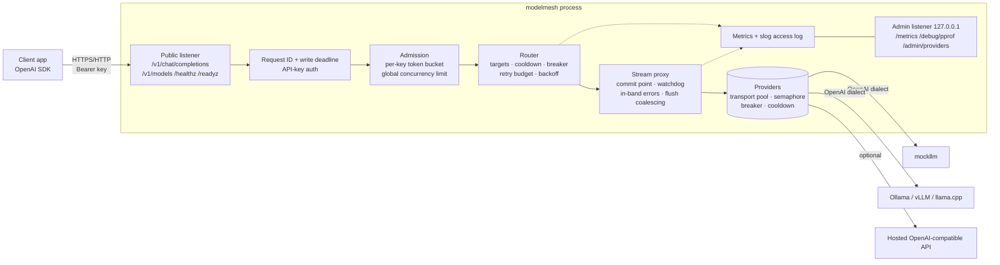
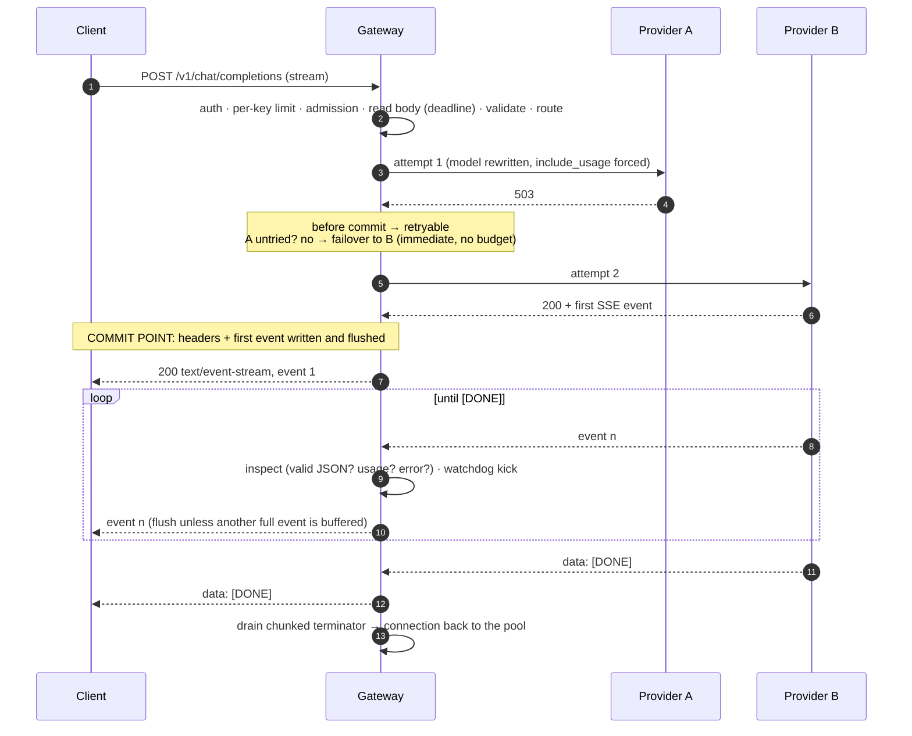

# Architecture

ModelMesh is a modular monolith: one process, a few small packages, and no runtime
dependencies outside the Go standard library. This document explains what each part does,
why it exists, and how a request moves through it.

## Components



| Package | Responsibility | Why it exists |
|---|---|---|
| `internal/config` | JSON config, defaults, secrets from env, validation that reports every error at once | Startup problems are found before the first request, all at once |
| `internal/api` | OpenAI request validation and rewriting; per-chunk inspection without re-encoding | The lingua franca (ADR 0002): touches only the fields the gateway acts on |
| `internal/sse` | Zero-allocation SSE reader (poolable) and writer | Streaming is the hot path; parsing must not allocate per event |
| `internal/resilience` | Breaker, retry budget, full-jitter backoff, `Retry-After`, semaphore, token bucket | Small, clock-injectable primitives with deterministic tests |
| `internal/provider` | One upstream: transport, concurrency limit, breaker, 429 cooldown | Keeps provider state in one place; one transport per provider isolates failures |
| `internal/gateway` | Handlers, routing loop, streaming, errors, metrics, server lifecycle | The application itself |
| `internal/metrics` | Prometheus text exposition | Standard library only (ADR 0006) |
| `internal/mock` | `mockllm` behavior | ₹0 development and fault injection (ADR 0007) |
| `cmd/*` | Thin `main` packages | Flags, signals, wiring |

There are no interfaces for single implementations. `provider.Provider` is a concrete
type, and an interface will appear when a second upstream dialect exists.

## Request lifecycle



If B stalls after the commit point, the watchdog cancels the attempt with
`errIdleTimeout`. The client then receives
`data: {"error":{"code":"upstream_stalled",...}}` and the stream closes without `[DONE]`.
Nothing is retried. See `docs/failure-semantics.md` for every case.

## Routing loop

For each request, the router walks the model's ordered target list, at most
`retry.max_attempts` times in total:

1. Skip the target, with no attempt, if it is in 429 cooldown, its breaker is open, or its
   provider concurrency limit is full.
2. If this provider already failed for this request, spend a retry-budget token (or stop)
   and wait a full-jitter backoff.
3. If the provider has not been tried, fail over immediately at no budget cost.
4. Attempt. Before the commit point, a retryable failure continues the loop and a
   non-retryable one (an upstream 4xx such as 400 or 422, or the client leaving) ends the
   request.
5. If no target could even be attempted, return 429 when every skip was a cooldown,
   otherwise 503.

## Contexts and cancellation

```
server base context ── cancelled with errShutdown after the shutdown grace period
 └─ request context (net/http) ── cancelled when the client disconnects
     └─ request deadline ── timeouts.request → errRequestTimeout
         └─ attempt context ── cancelled by the watchdog (errFirstTokenTimeout / errIdleTimeout),
                               by timeouts.attempt (non-streaming), or when the attempt ends
```

Every upstream read happens under the attempt context. When any ancestor is cancelled,
the read fails at once and the upstream connection is closed. That is how a client
disconnect reaches the provider; it took less than 1 ms in tests. `context.Cause` tells
the reasons apart, so each one gets the right outcome, status, and error code.

## Concurrency model

- Each request runs on the goroutine net/http gives it. The streaming loop is synchronous:
  read, inspect, write, flush. Backpressure is TCP flow control, not a buffer.
- Shared state is small and lock-light:
  - breaker: a mutex, taken once per attempt;
  - cooldown: an atomic CAS;
  - semaphores: buffered channels;
  - retry budget and token buckets: mutexes, taken once per request;
  - metric series: atomics, with map lookups behind an `RWMutex`.
- The only timers are the per-attempt watchdog (`time.AfterFunc`, lazily re-armed) and the
  backoff sleep. No goroutine is started per request beyond what net/http itself starts.

## Shutdown

On SIGTERM or SIGINT:

1. `/readyz` turns 503.
2. Listeners close and idle keep-alive connections drop.
3. In-flight requests, including streams, get `timeouts.shutdown_grace` to finish.
4. Whatever is left is cancelled with `errShutdown`. Streams then send a
   `gateway_shutdown` error event, and connections close after up to 2 s.

A second signal kills the process immediately.

## What is deliberately not here

The following are left out on purpose:

- multi-tenancy (ADR 0001);
- a second API dialect (ADR 0002);
- distributed state (ADR 0001);
- caching and guardrails;
- tracing (ADR 0006);
- hot reload.

`README.md` lists future work in priority order.
